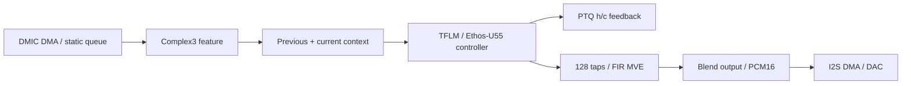

# Tích hợp Complex3 Conv5 — 2026-10-23

> 2026-11-08: Historical diagnostic/evidence guide. Its old build directories,
> wrappers and presets were removed. The custom PCB is now the product target
> in `build-debug/` and `build/`; use [current integration instructions](r2_custom_integration.md).
> Commands and numeric observations below describe the earlier session, not the current R2 acceptance.
> Diagnostic source modules remain isolated/model-free; do not recreate obsolete profiles.


Đã tích hợp vào source product và build/link được Debug, Release. Chưa nghiệm thu
board: `pyocd list` trả về `No available debug probes are connected` trong phiên này.
Không flash, không chạy audio thực, không suy ra deployment approval từ host/build.

## Identity và khả năng khôi phục

- Repo: `D:\TinyML-Hearing-Aids`; giữ các thay đổi có sẵn, làm trực tiếp theo route Light, không subagent.
- Package nguồn giữ nguyên: `D:\TinyML-Hearing-Aids\firmware_complex3_conv5_906b1d163f534778ba737eed737cab41`.
- Active: `D:\TinyML-Hearing-Aids\models\deepfir`.
- Snapshot ban đầu: `D:\TinyML-Hearing-Aids\tmp\complex3-integration-20261023\baseline`, gồm 76 file lúc bắt đầu, SHA-256, Git status và binary diff. Root README được bổ sung snapshot trước khi sửa.
- Compiled blob: **622128 byte**, SHA-256 `9e86a0b89bef324e9061e74646ceb012e14de76b3bdaf40c546cab6a3709e079`.
- Raw model nguồn: SHA-256 `93703f984b265736854f13c996fbad87a84363c3a60459098aab9a7fbc7a601e`.
- `source_integration_manifest.json` bảo toàn metadata upstream; `integration_manifest.json` ghi hash các file active. Declaration của blob đổi alignment 16 thành 32 byte, dữ liệu model giữ nguyên.
- Upstream vẫn là `EXPORTED_REQUIRES_COMPILED_PARITY_AND_BOARD_VALIDATION`, `deployment_approved=false`. Không mang nhãn `EXPERIMENTAL_BLOCKED` của model tháng 9 sang model mới.

## Pipeline và ranh giới module



`services/deepfir/deepfir_features.c` sở hữu analysis history, Hamming 256,
FFT CMSIS và feature ba kênh. `deepfir_model_adapter.c` sở hữu context, recurrent
feedback và dequantization taps. `deepfir_dsp.c` sở hữu FIR/history/crossfade/PCM.
`deepfir_inference_service.cpp` sở hữu interpreter, resolver, arena và tensor binding.

Giữ API `deepfir_inference_init/reset/process`, PCM16 16 kHz, mỗi lần đúng 16 sample.
Không đổi pins, clock, gain, codec hay DMA ownership. Không cấp phát heap trên đường audio;
interpreter/resolver dùng placement construction trong storage tĩnh trước audio.

| Semantic order | Ports | Shape |
| --- | --- | --- |
| feature_context, h, c | 0, 2, 1 | [1,2,129,3], [1,200], [1,200] |
| taps, h_next, c_next | 2, 0, 1 | [1,128], [1,200], [1,200] |

Startup kiểm tra số port, tên, shape, dtype INT16, bytes, qparams và vùng SRAM;
hot path dùng binding đã lưu. Context xếp previous trước current; từng bin xếp
magnitude03, real03, imag03. Công thức signed complex dùng epsilon `1e-16`.
FFT instance được khởi tạo bằng `arm_cfft_init_256_f32()`.

State giữ nguyên tọa độ PTQ. h copy trực tiếp; c giữ multiplier `1073741891`,
shift `30`. Bound integer chứng minh mọi INT16 code đều round về chính nó, nên có
thể copy nhanh mà không đổi phép feedback đã xuất. Host test quét đủ 65536 code và
kiểm tra thêm requantization/saturation khi thay qparams trong test seam.

FIR tính riêng previous/current response rồi blend output bằng raised cosine chuẩn
bị trước audio. Previous/current taps reset thành impulse tại tap 64. Không thêm
correction strength, normalization, minimum-phase hoặc delay shift ngoài controller.
PCM dùng half-away-from-zero và saturation; output không hữu hạn làm stream lỗi.

Khi DSP/inference lỗi, pipeline không submit frame đó, dừng transport, reset stream
và vô hiệu start cho đến init lại. Inference giữ fault latch, soft reset NPU khi
explicit init lại. Normal Release chạy liên tục và không log; probe/capture vẫn opt-in.

Dependency giữ `app -> services -> drivers -> board -> libs`: service dùng timing API
công khai của audio transport; kiểm tra NPU SRAM nằm trong driver/board. Model artifacts
chỉ được dùng trong inference service và binding/bridge thuộc service đó. Vendor `libs/`
không bị sửa, giữ một BSP Ethos-U core và một IRQ owner.

## Bằng chứng đã chạy

| Hạng mục | Kết quả |
| --- | --- |
| Configure Debug trước sửa compiler-sensitive code | Pass bằng script repo |
| Host suite | 95 tests pass |
| Feature scalar vs reference độc lập | 2000 hop; từng kênh <= 1 INT16 LSB, gồm silence/tiny/signed/saturation |
| Context, reset, state, lỗi, PCM | Pass host component tests |
| FIR | Reference convolution độc lập, sai số <= `2e-5 + 2e-6 * abs(reference)`, history/taps khớp |
| Binding compiled thật | FlatBuffer verifier và đối chiếu 3/3 name/port/index/shape/dtype/qparams; không Invoke |
| Debug / Release build-link | Pass Arm Compiler 6.24 |
| Blob trong cả hai `.bin` | Extract theo load address map, đủ 622128 byte, đúng compiled SHA-256 |
| MVE Release | Thumb ARMv8.1-M trong đúng map range: feature 110, FIR 48, FFT 177, vlog 48, vexp 49, q15 conversion 6 vector instructions |

Lệnh chính:

```powershell
python -m unittest discover -s tests -v
git diff --check
build.bat debug build
build.bat release build
python tools/verify_mve_disassembly.py build/M55M1_GestureAI.axf
python tools/report_model_sram.py build/M55M1_GestureAI.axf.map
```

Host GCC/tempfile và compiler build được chạy ngoài sandbox sau khi baseline xác định
lỗi quyền truy cập thư mục tạm. Không sửa test để bỏ qua PermissionError hay giảm assertion.
MVE verifier dùng `arm-none-eabi-objdump -m armv8.1-m.main -M force-thumb` cùng địa chỉ/size
từ linker map. Kiểm tra cũ chỉ tìm instruction toàn ảnh bằng fromelf có thể báo nhầm
khi Release strip mapping symbols; công cụ mới có regression test cho trường hợp này.

Debug và Release có startup component check cho feature MVE <= 1 LSB và FIR MVE
theo tolerance/state hiện có. Đây là code đã build; **chưa chạy trên board**.

## SRAM, stack và binary

| Thành phần | Debug | Release |
| --- | ---: | ---: |
| Model execution address | 0x20100000 | 0x20100000 |
| Blob | 622128 B | 622128 B |
| Model + length metadata trong U55_MODEL_RAM | 622132 B | 622132 B |
| Vùng model dành sẵn | 786432 B | 786432 B |
| Model headroom | 164300 B | 164300 B |
| Arena capacity | 65536 B | 65536 B |
| RW_RAM toàn firmware | 77980 B | 77764 B |
| Stack DTCM dành sẵn | 8192 B | 8192 B |

Debug callgraph báo 6296 byte **cộng phần unknown do cycles/function pointers**;
không coi đây là bound hoàn chỉnh. Release đã strip không cung cấp stack bound hữu ích.
Cần stack watermark trên board. `arena_used_bytes()` được log lúc Debug startup,
chưa có số thực từ board; map chỉ chứng minh capacity.

Model load image nằm APROM, startup scatter copy toàn blob vào `U55_MODEL_RAM`.
Runtime đăng ký immutable range, clean một lần và bỏ qua cache maintenance cho range
model ở mỗi invoke; buffer mutable tiếp tục theo cache policy hiện có.

Binary cuối:

- Debug: `D:\TinyML-Hearing-Aids\build-debug\M55M1_GestureAI.axf.bin`, 725408 byte,
  SHA-256 `308be860f700c8270a36b75caddcf5ebfc918952b7f927e40b0482465191790b`.
- Release: `D:\TinyML-Hearing-Aids\build\M55M1_GestureAI.axf.bin`, 711840 byte,
  SHA-256 `b30ad6fff19a90bc8f27572fcc8994a5bba3fa0ee3489dfc65592399bf257b8c`.

## Nghiệm thu board còn lại

1. Kết nối probe; xác nhận nRESET thực sự được nối cùng GND/VREF. Recovery vẫn qua
   SWDIO/SWCLK/nRESET, không giả định probe điều khiển reset khi dây không có.
2. Pins giữ nguyên: DMIC PB2 clock/PB3 data; I2S PF0 DO/PF1 LRCK/PB5 BCLK/PB4 MCLK;
   I2C PB1/PB0; debug UART1 PA2 RX/PA3 TX. PF0/PF1 đang liên quan đường SWD hiện hữu;
   cần xác nhận recovery/wiring thực tế trước flash, không đổi pin để né vấn đề.
3. Flash và verify image; kiểm tra Debug boot identity/address, tensor allocation,
   arena use và feature/FIR MVE readiness trước DMA. Chưa có bất kỳ kết quả này.
4. Audio mic -> enhanced waveform -> DAC: theo dõi NPU/DMA errors, clipping, sequence
   gaps và hành vi dừng/reset. Thu input/output đồng bộ bằng capture hiện có.
5. Đo Release feature/invoke/FIR/toàn pipeline; mỗi hop < 1 ms, không backlog tăng
   dần, không overrun/underrun khi ổn định. Nếu miss, tối ưu stage đã đo; giữ model,
   hop, clock, qparams. Compiler estimate hoặc timing tháng 9 không thay thế phép đo.
6. Soak 30 phút, ghi counters trước/sau, tách underrun lúc khởi động; đánh giá waveform,
   độ trễ thực và stack watermark. `target_delay=64` không phải mic-to-ear latency.

Không chạy neural replay/FVP hay image replay riêng theo yêu cầu. Compiled recurrent
parity, chất lượng, capture-to-DAC/acoustic latency và deployment approval vẫn chưa xác nhận.
